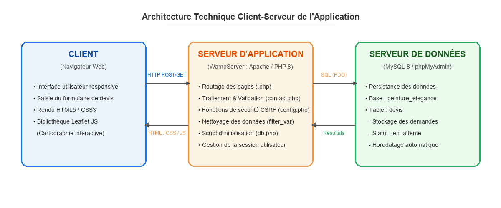

# 🏠 Site vitrine & back-office, entreprise de peinture / rénovation

Projet réalisé pendant mon **stage de BTS SIO (option SLAM)** : site vitrine complet pour une entreprise de peinture et de rénovation à Mâcon, avec un **espace d'administration** sur mesure.

## ✨ Fonctionnalités

**Site public**
- Pages : accueil, prestations, réalisations, à propos, contact, mentions légales
- Formulaire de **demande de devis / contact** protégé (jeton **CSRF**)
- **SEO** : sitemap et robots générés dynamiquement, URL propres (`.htaccess`)

**Back-office (`admin.php`)**
- Connexion sécurisée (mots de passe hachés `password_hash`, réinitialisation par lien à usage unique)
- Gestion des **demandes de devis** et **export PDF**
- **CMS** : modification des textes, prestations, réalisations et images
- Paramètres de l'entreprise (coordonnées, horaires, zone d'intervention)
- **Statistiques de visites** (IP anonymisées par hachage)

## 🛠️ Technologies

PHP 8 · MySQL (PDO) · HTML5 · CSS3 · JavaScript · Apache (WampServer)

## 🚀 Installation locale

1. Copier le dossier dans `C:\wamp64\www\`
2. Créer une base MySQL `peinture_elegance` (les tables sont créées automatiquement au premier lancement)
3. Définir les identifiants de l'admin via les variables d'environnement `ADMIN_DEFAULT_USER`, `ADMIN_DEFAULT_PASSWORD` et `ADMIN_DEFAULT_EMAIL`, ou modifier `config.php`
4. Ouvrir `http://localhost/site-peinture-renovation/`

> ⚠️ Le mot de passe par défaut doit être changé dès la première connexion (le back-office affiche un avertissement tant que ce n'est pas fait).

## 👤 Auteur

**Isa Aksu** ([@isaaksu66](https://github.com/isaaksu66)), étudiant en BTS SIO SLAM

© 2026 Isa Aksu. Tous droits réservés, voir [LICENSE](LICENSE).
